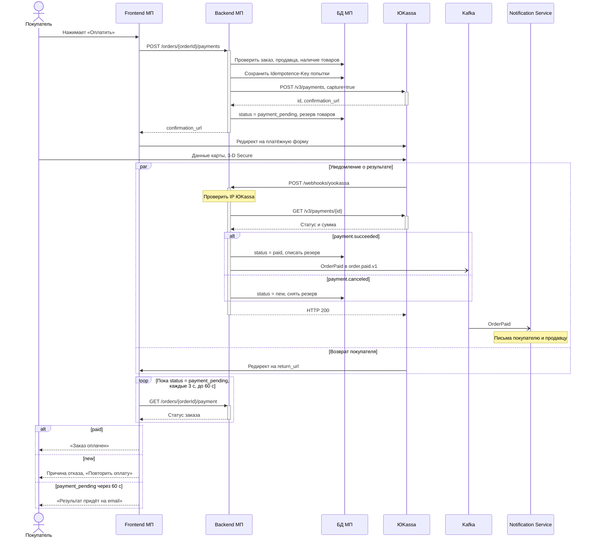

# Интеграция с ЮKassa для маркетплейса N [технический Use Case]

> О проекте: маркетплейс N (далее МП) продаёт ювелирные изделия малых брендов и частных мастеров. Продавцы работают как ИП или ООО. Оплата идёт через ЮKassa по схеме для маркетплейсов: сплитование платежей. Название компании и данные изменены.

**Оглавление**

- [Общее описание](#общее-описание)
  - [API-документация внешней системы](#api-документация-внешней-системы)
  - [Особенности и известные проблемы](#особенности-и-известные-проблемы)
- [Сценарий работы (Use Case)](#сценарий-работы-use-case)
  - [Роли пользователей](#роли-пользователей)
  - [Системы](#системы)
  - [Предусловие](#предусловие)
  - [Основной сценарий](#основной-сценарий)
  - [Альтернативные сценарии и обработка ошибок](#альтернативные-сценарии-и-обработка-ошибок)
  - [Постусловие](#постусловие)
- [Маппинг данных](#маппинг-данных)
- [Примеры запросов и ответов](#примеры-запросов-и-ответов)
- [Дополнительно: UML-Sequence процесса оплаты](#дополнительно-uml-sequence-процесса-оплаты)

## Общее описание

В этой статье описан процесс онлайн-оплаты заказа в веб-приложении МП через ЮKassa.

**Что это:**

Интеграция Backend МП с ЮKassa для безопасного приёма оплаты заказов.

**Зачем:**

- Подключить онлайн-оплату, чтобы покупатель оплачивал заказ сразу при оформлении.
- Не получать и не хранить данные банковских карт: покупатель вводит их на стороне ЮKassa.
- Автоматически распределять оплату: доля продавца уходит в его магазин в ЮKassa, комиссия остаётся у МП.

**Для кого:**

- Для покупателей, которые хотят быстро и безопасно оплатить украшение онлайн.
- Для продавцов, которым не нужны своя касса и эквайринг.
- Для владельцев МП, которые получают комиссию с каждой оплаты.

### API-документация внешней системы

- [Сплитование платежей: обзор](https://yookassa.ru/developers/solutions-for-platforms/marketplaces/basics)
- [Приём платежей со сплитованием](https://yookassa.ru/developers/solutions-for-platforms/marketplaces/payments)
- [Справочник API ЮKassa](https://yookassa.ru/developers/api)

### Особенности и известные проблемы

1. Перед работой над задачей должны быть настроены:
   1. идентификатор магазина МП (shopId) и секретный ключ;
   2. адрес для уведомлений ЮKassa;
   3. `account_id` магазина продавца в ЮKassa в профиле каждого верифицированного продавца.
2. В одном заказе товары только одного продавца. Корзина с товарами нескольких продавцов делится на заказы, каждый оплачивается отдельно.
3. Доставку организует продавец, поэтому вся сумма заказа вместе с доставкой переводится продавцу, МП удерживает комиссию. ⚠️ TBD: если доставку возьмёт на себя МП, стоимость доставки нужно будет исключить из `transfers[0].amount`.
4. СБП в сплитовании не поддерживается.
5. Чеки по 54-ФЗ в запросе платежа не передаются, ЮKassa принимает их отдельным запросом. Формирование чеков будет сделано отдельной задачей, внесено в Backlog.
6. Возврат платежей после оплаты пока не поддержан, внесено в Backlog. Возврат делает администратор вручную через личный кабинет ЮKassa.
7. Статусы заказа в этом сценарии. Статусы заказа МП и статусы платежа ЮKassa не совпадают: у заказа `cancelled`, у платежа в ЮKassa `canceled`.

| Статус заказа | Что значит | Статус платежа в ЮKassa |
| --- | --- | --- |
| `new` | Заказ сформирован, платежа нет или прошлая попытка не прошла | нет или `canceled` |
| `payment_pending` | Платёж создан, покупатель на платёжной форме | `pending` |
| `paid` | Заказ оплачен | `succeeded` |
| `cancelled` | Заказ отменён: оплата не поступила за 30 минут | `pending` истёк или платежа нет |

## Сценарий работы (Use Case)

### Роли пользователей

- Покупатель.
- Продавец. В сценарии не действует, получает уведомление о новом оплаченном заказе.

### Системы

- Frontend МП (веб-приложение покупателя)
- Backend МП
- БД МП
- Kafka
- Notification Service МП (отправляет письма)
- ЮKassa

### Предусловие

- Покупатель авторизован, заказ сформирован со статусом `new`, все товары в нём от одного продавца.
- Продавец верифицирован, у него есть `account_id` магазина в ЮKassa.
- Покупатель находится на экране оформления заказа, доставка выбрана и рассчитана.
- На экране предлагается проверить ФИО, телефон и email получателя. На email придёт подтверждение оплаты.

### Основной сценарий

1. Покупатель проверяет ФИО, телефон и email.
2. Покупатель нажимает «Оплатить».
3. Frontend проверяет полноту и формат данных и отправляет на Backend МП запрос `POST /orders/{orderId}/payments`.
4. Backend МП:
   1. проверяет формат ФИО, телефона и email;
   2. по `{orderId}` проверяет в БД, что заказ принадлежит покупателю и имеет статус `new`;
   3. проверяет, что продавец верифицирован и товары есть в наличии;
   4. считает сумму заказа и комиссию МП;
   5. генерирует `Idempotence-Key` для этой попытки оплаты и сохраняет его в БД. Повторные запросы по этой попытке идут с тем же ключом, поэтому ЮKassa не создаст второй платёж.
5. Backend МП отправляет в ЮKassa запрос на создание платежа `POST /v3/payments` с заголовком `Idempotence-Key`. Маппинг данных описан в разделе [Маппинг данных](#маппинг-данных).
6. ЮKassa возвращает в ответ:
   1. `id`: идентификатор платежа в ЮKassa;
   2. `confirmation.confirmation_url`: ссылку на платёжную форму ЮKassa. Данные карты покупатель вводит на стороне ЮKassa, МП к ним доступа не имеет.
7. Backend МП сохраняет в БД `id` и `confirmation_url`, резервирует товары на 30 минут и обновляет статус заказа: `status = payment_pending`.
8. Backend МП возвращает на Frontend данные заказа и платежа, включая `confirmation_url`.
9. Frontend перенаправляет покупателя на платёжную форму ЮKassa.
10. Покупатель вводит данные карты и проходит 3-D Secure на стороне ЮKassa.
11. ЮKassa списывает деньги, зачисляет долю продавца в его магазин, комиссию МП и параллельно:
    1. сообщает Backend МП о результате: уведомление `payment.succeeded` на `POST /webhooks/yookassa`;
    2. перенаправляет покупателя на `return_url`.
12. Backend МП:
    1. проверяет, что уведомление пришло с IP-адреса ЮKassa;
    2. находит заказ по `metadata.order_id`, запрашивает актуальный статус `GET /v3/payments/{id}` и сверяет сумму с заказом;
    3. обновляет статус заказа `status = paid` и списывает зарезервированные товары;
    4. публикует событие `OrderPaid` в топик Kafka `order.paid.v1`. Notification Service читает событие и отправляет письмо об оплате покупателю и письмо о новом заказе продавцу;
    5. отвечает ЮKassa HTTP 200.
13. Frontend получает статус через `GET /orders/{orderId}/payment` и показывает экран «Заказ оплачен».

### Альтернативные сценарии и обработка ошибок

**1А.** Данные ФИО, телефон и email предзаполнены из профиля покупателя.

**3.** Ошибки показываются в порядке проверок, одновременно только одна.

**3А.** Не заполнено обязательное поле. Подсветить поле красным, под ним текст: «Необходимо заполнить».

**3Б.** Телефон не соответствует формату +7 XXX XXX XX XX или email не соответствует формату ------@----.-----. Подсветить поле красным, текст: «Неверный формат».

**3В.** Backend МП не ответил в течение 30 секунд. Показать: `{"message": "Сервис временно недоступен. Попробуйте ещё раз"}`

**3Г.** Нет доступа к сети Интернет. Показать: `{"message": "Проверьте соединение с Интернетом"}`

**4А.** Backend МП выявил ошибку формата ФИО, телефона или email. Вернуть текст ошибки как в 3Б. Код ответа: HTTP 400.

**4Б.** Заказ в ином статусе, не `new`:

- `payment_pending`: вернуть сохранённую ссылку на платёжную форму. Новый платёж не создаётся. Если с создания платежа прошло больше 30 минут, заказ уже отменён фоновой задачей (ветка 10А), обработать как `cancelled`.
- `paid`: вернуть HTTP 409 `{"message": "Заказ уже оплачен"}`
- `cancelled`: вернуть HTTP 409 `{"message": "Заказ отменён. Оформите его заново"}`

**4В.** Товара нет в наличии или продавец заблокирован. Вернуть HTTP 409 `{"message": "Заказ нельзя оплатить. Проверьте корзину"}`

**5А.** Получена ошибка авторизации в ЮKassa, HTTP 401. Backend МП:

- записывает в лог информацию о неуспешном запросе с приоритетом «критическая»;
- возвращает HTTP 500 `{"message": "Сервис временно недоступен. Попробуйте позже"}`

**5Б.** Превышено время ожидания ответа от ЮKassa (10 секунд) или получена ошибка HTTP 500. Backend МП:

- повторяет запрос один раз с тем же `Idempotence-Key`. Общее время ожидания не превышает 25 секунд, это меньше таймаута Frontend в 30 секунд (ветка 3В);
- если ответа нет, записывает в лог с приоритетом «предупреждение» и возвращает HTTP 500 `{"message": "Сервис временно недоступен. Попробуйте ещё раз"}`;
- платёж в ЮKassa мог успеть создаться. При повторном нажатии «Оплатить» Backend МП отправляет запрос с тем же `Idempotence-Key` и получает этот же платёж, второй не создаётся.

**5В.** Получена ошибка формата HTTP 400 от ЮKassa. Backend МП записывает в лог с приоритетом «критическая» (сломался маппинг данных) и возвращает HTTP 500 `{"message": "Сервис временно недоступен. Попробуйте позже"}`

**5Г.** Получена иная ошибка от ЮKassa. Backend МП записывает в лог с приоритетом «предупреждение» и возвращает HTTP 500 `{"message": "Что-то пошло не так. Попробуйте ещё раз"}`

**10А.** Покупатель закрыл платёжную форму. Через 30 минут фоновая задача Backend МП снимает резерв товаров и обновляет статус заказа `status = cancelled`.

**10Б.** Банк отклонил оплату. ЮKassa присылает уведомление `payment.canceled` с причиной. Backend МП снимает резерв и возвращает заказу `status = new`. Frontend показывает причину и предлагает повторить оплату. Повторная оплата идёт как новая попытка с новым `Idempotence-Key`.

**12А.** Уведомление пришло не с IP-адреса ЮKassa. Не обрабатывать, вернуть HTTP 403, записать в лог с приоритетом «критическая».

**12Б.** Повторное уведомление по тому же платежу. Вернуть HTTP 200, статус заказа не менять.

**12В.** Оплата пришла по заказу в статусе `cancelled` (позже 30 минут). Статус заказа не менять, записать в лог с приоритетом «предупреждение» и создать задачу администратору на возврат через личный кабинет ЮKassa. ⚠️ TBD: автоматический возврат внесён в Backlog.

**12Г.** Уведомление не пришло. Раз в 5 минут Backend МП запрашивает `GET /v3/payments/{id}` по заказам в `payment_pending` и обрабатывает ответ как уведомление.

**13А.** Покупатель вернулся на `return_url` раньше, чем Backend МП обработал уведомление: статус заказа ещё `payment_pending`. Frontend показывает экран «Оплата обрабатывается» и повторяет `GET /orders/{orderId}/payment` каждые 3 секунды до 60 секунд. Если статус не изменился, показать: «Мы проверяем оплату. Результат придёт на email».

**13Б.** Статус заказа `new` после отказа банка (ветка 10Б). Frontend показывает причину отказа и кнопку «Повторить оплату».

⚠️ TBD: и другие альтернативные сценарии и ошибки на оставшиеся шаги основного сценария.

### Постусловие

- Заказ в статусе `paid`, товары списаны со склада.
- В ЮKassa платёж в статусе `succeeded`: доля продавца зачислена в его магазин, комиссия у МП.
- Покупатель получил письмо об оплате, продавец получил уведомление о новом заказе.

## Маппинг данных

### Запрос МП → ЮKassa: создание платежа `POST /v3/payments` (шаг 5)

| Поле ЮKassa | Источник в МП | Пример |
| --- | --- | --- |
| заголовок `Idempotence-Key` | ключ попытки оплаты, сгенерирован на шаге 4.5 | `6b1f0c2e-7d3a-4f5b-8e9c-0a1b2c3d4e5f` |
| `amount.value` | сумма заказа: товары и доставка | `"17000.00"` |
| `amount.currency` | константа | `"RUB"` |
| `capture` | константа: деньги списываются сразу после оплаты | `true` |
| `confirmation.type` | константа | `"redirect"` |
| `confirmation.return_url` | адрес страницы результата оплаты в МП с `orderId` | `https://mp.example/orders/{orderId}/payment-result` |
| `description` | «Заказ № » + номер заказа | `"Заказ № 10452"` |
| `metadata.order_id` | идентификатор заказа | `"8f3c1e2a-…"` |
| `transfers[0].account_id` | `account_id` магазина продавца в ЮKassa из профиля продавца | `"123456"` |
| `transfers[0].amount` | сумма заказа (см. особенность 3) | `"17000.00"` |
| `transfers[0].platform_fee_amount` | комиссия МП: сумма заказа × ставка комиссии. ⚠️ TBD: тариф и кто платит комиссию ЮKassa | `"1700.00"` |
| `transfers[0].description` | юридическое наименование продавца, сумма перевода и номер заказа. ЮKassa требует указывать наименование и сумму | `"ИП Смирнова А. В. 17000 руб., заказ № 10452"` |

Поля ФИО, телефон и email получателя в ЮKassa не передаются: они сохраняются в заказе и нужны для письма покупателю.

### Ответ и уведомление ЮKassa → МП (шаги 6, 7, 12)

| Поле ЮKassa | Куда записывается в МП | Когда |
| --- | --- | --- |
| `id` | идентификатор платежа в ЮKassa в заказе, `payment.id` в API МП | шаг 7 |
| `confirmation.confirmation_url` | ссылка на платёжную форму в заказе, `payment.confirmationUrl` в API МП | шаг 7 |
| `status` | статус платежа в заказе и статус заказа по таблице статусов | шаги 7, 12 |
| `metadata.order_id` | по нему Backend МП находит заказ при обработке уведомления | шаг 12 |
| `amount.value` | сверяется с суммой заказа, при расхождении запись в лог «критическая», статус не меняется | шаг 12 |
| `captured_at` | дата оплаты в заказе, `payment.paidAt` в API МП | шаг 12 |
| `cancellation_details.reason` | причина отказа, показывается покупателю | ветка 10Б |

## Примеры запросов и ответов

Значения в примерах условные. Суммы в API ЮKassa передаются строкой с двумя знаками после точки.

### API МП: создание платежа (шаг 3)

Запрос:

```http
POST /orders/8f3c1e2a-5b7d-4e1f-9a2c-3d4e5f6a7b8c/payments
Authorization: Bearer <токен покупателя>
Content-Type: application/json

{
  "recipient": {
    "fullName": "Иванова Анна Сергеевна",
    "phone": "+79161234567",
    "email": "anna@example.com"
  }
}
```

Ответ HTTP 201:

```json
{
  "orderId": "8f3c1e2a-5b7d-4e1f-9a2c-3d4e5f6a7b8c",
  "orderNumber": "10452",
  "status": "payment_pending",
  "amount": { "value": "17000.00", "currency": "RUB" },
  "payment": {
    "id": "2e8a9f7c-000f-5000-9000-1b6c4a2d3e4f",
    "status": "pending",
    "confirmationUrl": "https://yoomoney.ru/checkout/payments/v2/contract?orderId=2e8a9f7c-000f-5000-9000-1b6c4a2d3e4f"
  }
}
```

Ответ HTTP 409 (ветка 4Б):

```json
{ "message": "Заказ уже оплачен" }
```

### ЮKassa: создание платежа (шаги 5 и 6)

Запрос:

```http
POST https://api.yookassa.ru/v3/payments
Authorization: Basic <shopId:секретный ключ в Base64>
Idempotence-Key: 6b1f0c2e-7d3a-4f5b-8e9c-0a1b2c3d4e5f
Content-Type: application/json

{
  "amount": { "value": "17000.00", "currency": "RUB" },
  "capture": true,
  "confirmation": {
    "type": "redirect",
    "return_url": "https://mp.example/orders/8f3c1e2a-5b7d-4e1f-9a2c-3d4e5f6a7b8c/payment-result"
  },
  "description": "Заказ № 10452",
  "metadata": { "order_id": "8f3c1e2a-5b7d-4e1f-9a2c-3d4e5f6a7b8c" },
  "transfers": [
    {
      "account_id": "123456",
      "amount": { "value": "17000.00", "currency": "RUB" },
      "platform_fee_amount": { "value": "1700.00", "currency": "RUB" },
      "description": "ИП Смирнова А. В. 17000 руб., заказ № 10452"
    }
  ]
}
```

Ответ HTTP 200:

```json
{
  "id": "2e8a9f7c-000f-5000-9000-1b6c4a2d3e4f",
  "status": "pending",
  "paid": false,
  "amount": { "value": "17000.00", "currency": "RUB" },
  "confirmation": {
    "type": "redirect",
    "confirmation_url": "https://yoomoney.ru/checkout/payments/v2/contract?orderId=2e8a9f7c-000f-5000-9000-1b6c4a2d3e4f"
  },
  "created_at": "2026-10-22T09:46:12.000Z",
  "description": "Заказ № 10452",
  "metadata": { "order_id": "8f3c1e2a-5b7d-4e1f-9a2c-3d4e5f6a7b8c" },
  "transfers": [
    {
      "account_id": "123456",
      "amount": { "value": "17000.00", "currency": "RUB" },
      "platform_fee_amount": { "value": "1700.00", "currency": "RUB" },
      "status": "pending"
    }
  ],
  "test": false
}
```

### ЮKassa: уведомление о результате платежа (шаг 11)

```http
POST https://mp.example/webhooks/yookassa
Content-Type: application/json

{
  "type": "notification",
  "event": "payment.succeeded",
  "object": {
    "id": "2e8a9f7c-000f-5000-9000-1b6c4a2d3e4f",
    "status": "succeeded",
    "paid": true,
    "amount": { "value": "17000.00", "currency": "RUB" },
    "captured_at": "2026-10-22T09:48:40.000Z",
    "payment_method": {
      "type": "bank_card",
      "card": { "first6": "555555", "last4": "4444", "card_type": "MasterCard" }
    },
    "metadata": { "order_id": "8f3c1e2a-5b7d-4e1f-9a2c-3d4e5f6a7b8c" }
  }
}
```

Ответ Backend МП: HTTP 200 без тела.

При отказе банка (ветка 10Б) приходит `event: payment.canceled`, а в `object.cancellation_details` указана причина, например `"reason": "insufficient_funds"`.

### API МП: статус оплаты (шаг 13)

Запрос:

```http
GET /orders/8f3c1e2a-5b7d-4e1f-9a2c-3d4e5f6a7b8c/payment
Authorization: Bearer <токен покупателя>
```

Ответ HTTP 200:

```json
{
  "orderId": "8f3c1e2a-5b7d-4e1f-9a2c-3d4e5f6a7b8c",
  "status": "paid",
  "payment": {
    "id": "2e8a9f7c-000f-5000-9000-1b6c4a2d3e4f",
    "status": "succeeded",
    "paidAt": "2026-10-22T09:48:40.000Z"
  }
}
```

## Дополнительно: UML-Sequence процесса оплаты

UML-Sequence диаграмма показывает порядок вызовов в основном сценарии. Ошибки и таймауты описаны в альтернативных сценариях.

Обозначения: сплошная стрелка с закрашенным концом означает синхронный вызов, пунктирная означает ответ, стрелка с открытым концом означает асинхронное сообщение через Kafka.


