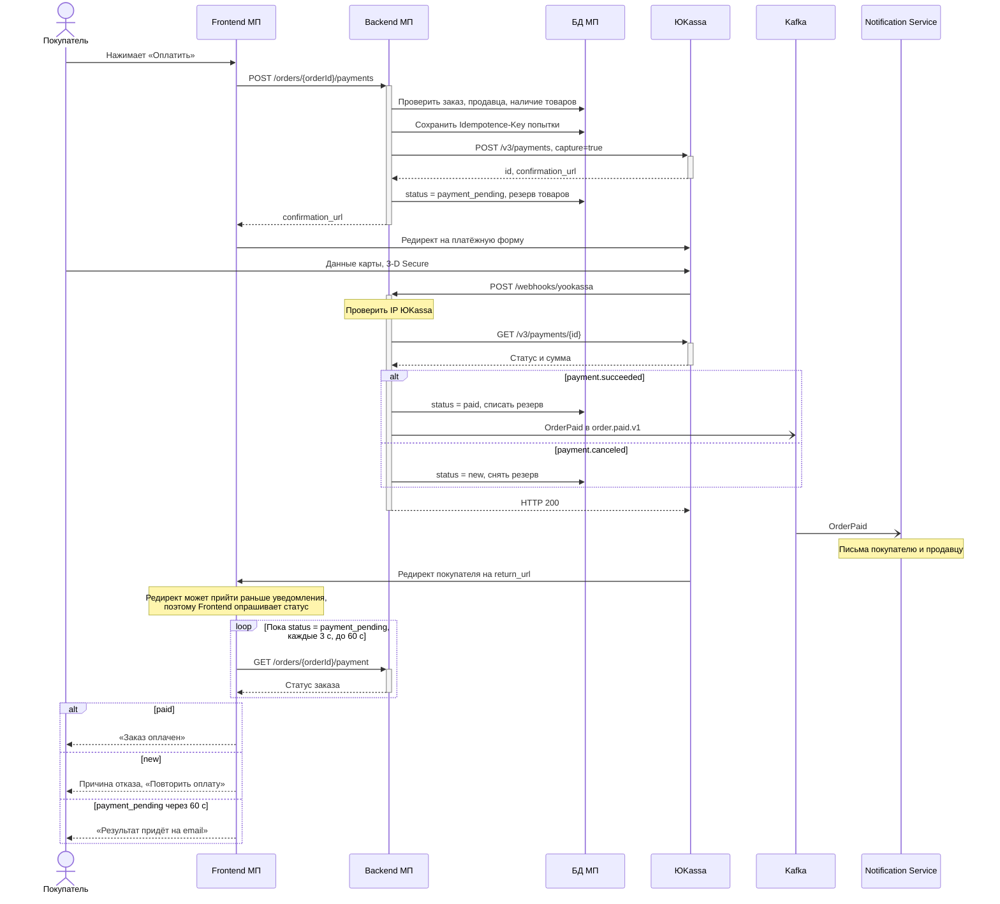

# Интеграция с ЮKassa для маркетплейса N [технический Use Case]

> О проекте: маркетплейс N (далее МП) продаёт ювелирные изделия малых брендов и частных мастеров. Продавцы работают как ИП или ООО. Оплата идёт через ЮKassa по схеме для маркетплейсов: сплитование платежей. Название компании и данные изменены.

**Оглавление**

- [Общее описание](#общее-описание)
  - [API-документация внешней системы](#api-документация-внешней-системы)
  - [Особенности и известные проблемы](#особенности-и-известные-проблемы)
- [Сценарий работы (Use Case)](#сценарий-работы-use-case)
  - [Роли пользователей](#роли-пользователей)
  - [Системы](#системы)
  - [Предусловие](#предусловие)
  - [Основной сценарий](#основной-сценарий)
  - [Альтернативные сценарии и обработка ошибок](#альтернативные-сценарии-и-обработка-ошибок)
  - [Постусловие](#постусловие)
- [Маппинг данных](#маппинг-данных)
- [Примеры запросов и ответов](#примеры-запросов-и-ответов)
- [Дополнительно: UML-Sequence процесса оплаты](#дополнительно-uml-sequence-процесса-оплаты)

## Общее описание

В этой статье описан процесс онлайн-оплаты заказа в веб-приложении МП через ЮKassa.

**Что это:**

Интеграция Backend МП с ЮKassa для безопасного приёма оплаты заказов.

**Зачем:**

- Подключить онлайн-оплату, чтобы покупатель оплачивал заказ сразу при оформлении.
- Не получать и не хранить данные банковских карт: покупатель вводит их на стороне ЮKassa.
- Автоматически распределять оплату: доля продавца уходит в его магазин в ЮKassa, комиссия остаётся у МП.

**Для кого:**

- Для покупателей, которые хотят быстро и безопасно оплатить украшение онлайн.
- Для продавцов, которым не нужны своя касса и эквайринг.
- Для владельцев МП, которые получают комиссию с каждой оплаты.

### API-документация внешней системы

- [Сплитование платежей: обзор](https://yookassa.ru/developers/solutions-for-platforms/marketplaces/basics)
- [Приём платежей со сплитованием](https://yookassa.ru/developers/solutions-for-platforms/marketplaces/payments)
- [Справочник API ЮKassa](https://yookassa.ru/developers/api)

### Особенности и известные проблемы

1. Перед работой над задачей должны быть настроены:
   1. идентификатор магазина МП (shopId) и секретный ключ;
   2. адрес для уведомлений ЮKassa;
   3. `account_id` магазина продавца в ЮKassa в профиле каждого верифицированного продавца.
2. В одном заказе товары только одного продавца. Корзина с товарами нескольких продавцов делится на заказы, каждый оплачивается отдельно.
3. Доставку организует продавец, поэтому вся сумма заказа вместе с доставкой переводится продавцу, МП удерживает комиссию. ⚠️ TBD: если доставку возьмёт на себя МП, стоимость доставки нужно будет исключить из `transfers[0].amount`.
4. СБП в сплитовании не поддерживается.
5. Чеки по 54-ФЗ в запросе платежа не передаются, ЮKassa принимает их отдельным запросом. Формирование чеков будет сделано отдельной задачей, внесено в Backlog.
6. Возврат платежей после оплаты пока не поддержан, внесено в Backlog. Возврат делает администратор вручную через личный кабинет ЮKassa.
7. Статусы заказа в этом сценарии. Статусы заказа МП и статусы платежа ЮKassa не совпадают: у заказа `cancelled`, у платежа в ЮKassa `canceled`.

| Статус заказа | Что значит | Статус платежа в ЮKassa |
| --- | --- | --- |
| `new` | Заказ сформирован, платежа нет или прошлая попытка не прошла | нет или `canceled` |
| `payment_pending` | Платёж создан, покупатель на платёжной форме | `pending` |
| `paid` | Заказ оплачен | `succeeded` |
| `cancelled` | Заказ отменён: оплата не поступила за 30 минут | `pending` истёк или платежа нет |

## Сценарий работы (Use Case)

### Роли пользователей

- Покупатель.
- Продавец. В сценарии не действует, получает уведомление о новом оплаченном заказе.

### Системы

- Frontend МП (веб-приложение покупателя)
- Backend МП
- БД МП
- Kafka
- Notification Service МП (отправляет письма)
- ЮKassa

### Предусловие

- Покупатель авторизован, заказ сформирован со статусом `new`, все товары в нём от одного продавца.
- Продавец верифицирован, у него есть `account_id` магазина в ЮKassa.
- Покупатель находится на экране оформления заказа, доставка выбрана и рассчитана.
- На экране предлагается проверить ФИО, телефон и email получателя. На email придёт подтверждение оплаты.

### Основной сценарий

1. Покупатель проверяет ФИО, телефон и email.
2. Покупатель нажимает «Оплатить».
3. Frontend проверяет полноту и формат данных и отправляет на Backend МП запрос `POST /orders/{orderId}/payments`.
4. Backend МП:
   1. проверяет формат ФИО, телефона и email;
   2. по `{orderId}` проверяет в БД, что заказ принадлежит покупателю и имеет статус `new`;
   3. проверяет, что продавец верифицирован и товары есть в наличии;
   4. считает сумму заказа и комиссию МП;
   5. генерирует `Idempotence-Key` для этой попытки оплаты и сохраняет его в БД. Повторные запросы по этой попытке идут с тем же ключом, поэтому ЮKassa не создаст второй платёж.
5. Backend МП отправляет в ЮKassa запрос на создание платежа `POST /v3/payments` с заголовком `Idempotence-Key`. Маппинг данных описан в разделе [Маппинг данных](#маппинг-данных).
6. ЮKassa возвращает в ответ:
   1. `id`: идентификатор платежа в ЮKassa;
   2. `confirmation.confirmation_url`: ссылку на платёжную форму ЮKassa. Данные карты покупатель вводит на стороне ЮKassa, МП к ним доступа не имеет.
7. Backend МП сохраняет в БД `id` и `confirmation_url`, резервирует товары на 30 минут и обновляет статус заказа: `status = payment_pending`.
8. Backend МП возвращает на Frontend данные заказа и платежа, включая `confirmation_url`.
9. Frontend перенаправляет покупателя на платёжную форму ЮKassa.
10. Покупатель вводит данные карты и проходит 3-D Secure на стороне ЮKassa.
11. ЮKassa списывает деньги, зачисляет долю продавца в его магазин, комиссию МП и параллельно:
    1. сообщает Backend МП о результате: уведомление `payment.succeeded` на `POST /webhooks/yookassa`;
    2. перенаправляет покупателя на `return_url`.
12. Backend МП:
    1. проверяет, что уведомление пришло с IP-адреса ЮKassa;
    2. находит заказ по `metadata.order_id`, запрашивает актуальный статус `GET /v3/payments/{id}` и сверяет сумму с заказом;
    3. обновляет статус заказа `status = paid` и списывает зарезервированные товары;
    4. публикует событие `OrderPaid` в топик Kafka `order.paid.v1`. Notification Service читает событие и отправляет письмо об оплате покупателю и письмо о новом заказе продавцу;
    5. отвечает ЮKassa HTTP 200.
13. Frontend получает статус через `GET /orders/{orderId}/payment` и показывает экран «Заказ оплачен».

### Альтернативные сценарии и обработка ошибок

**Альтернативный сценарий 1. ЮKassa временно недоступна.** Начинается на шаге 5.

1. ЮKassa не ответила за 10 секунд или вернула HTTP 500.
2. Backend МП повторяет запрос один раз с тем же `Idempotence-Key`. Благодаря этому ключу ЮKassa не создаст второй платёж, если первый всё-таки прошёл.
3. Если ответ получен, переход к шагу 6 основного сценария.
4. Если ответа снова нет, Backend МП пишет в лог с приоритетом «предупреждение» и возвращает Frontend HTTP 500. Всё ожидание укладывается в 25 секунд, меньше таймаута Frontend в 30 секунд.

   ```json
   { "message": "Сервис временно недоступен. Попробуйте ещё раз" }
   ```

5. Frontend показывает текст из ответа. Возврат к шагу 2 основного сценария.

**Альтернативный сценарий 2. ЮKassa отклонила запрос.** Начинается на шаге 5.

1. ЮKassa вернула HTTP 401 (неверный ключ магазина) или HTTP 400 (ошибка в данных запроса).
2. Backend МП не повторяет запрос и пишет в лог с приоритетом «критическая».
3. Backend МП возвращает Frontend HTTP 500.

   ```json
   { "message": "Сервис временно недоступен. Попробуйте позже" }
   ```

4. Frontend показывает текст из ответа. Сценарий завершается.

**Альтернативный сценарий 3. Банк отклонил оплату.** Начинается на шаге 11.

1. ЮKassa присылает уведомление `payment.canceled` с причиной отказа.

   ```json
   {
     "type": "notification",
     "event": "payment.canceled",
     "object": {
       "id": "2e8a9f7c-000f-5000-9000-1b6c4a2d3e4f",
       "status": "canceled",
       "paid": false,
       "cancellation_details": { "party": "payment_network", "reason": "insufficient_funds" },
       "metadata": { "order_id": "8f3c1e2a-5b7d-4e1f-9a2c-3d4e5f6a7b8c" }
     }
   }
   ```

2. Backend МП проверяет уведомление, как на шагах 12.1 и 12.2.
3. Backend МП снимает резерв товаров, возвращает заказ в `new`, сохраняет причину отказа и отвечает ЮKassa HTTP 200.
4. Frontend запрашивает статус `GET /orders/{orderId}/payment` и получает:

   ```json
   {
     "orderId": "8f3c1e2a-5b7d-4e1f-9a2c-3d4e5f6a7b8c",
     "status": "new",
     "payment": { "status": "canceled", "cancelReason": "insufficient_funds" }
   }
   ```

5. Frontend показывает «Недостаточно средств на карте» и кнопку «Повторить оплату».
6. Возврат к шагу 2 основного сценария. Повторная оплата идёт с новым `Idempotence-Key`.

**Альтернативный сценарий 4. Покупатель не оплатил заказ за 30 минут.** Начинается на шаге 10.

1. Покупатель закрыл платёжную форму, уведомление от ЮKassa не приходит.
2. Через 30 минут фоновая задача Backend МП снимает резерв товаров и переводит заказ в `cancelled`.
3. Если оплата всё же придёт позже, Backend МП не меняет статус заказа, пишет в лог с приоритетом «предупреждение» и создаёт задачу администратору на возврат денег через личный кабинет ЮKassa. ⚠️ TBD: автоматический возврат внесён в Backlog.
4. Сценарий завершается.

**Альтернативный сценарий 5. Уведомление от ЮKassa не пришло.** Начинается на шаге 12.

1. Покупатель оплатил заказ, но уведомление до Backend МП не дошло.
2. Раз в 5 минут фоновая задача Backend МП запрашивает `GET /v3/payments/{id}` по заказам в статусе `payment_pending`.
3. Backend МП обрабатывает ответ как уведомление: при `"status": "succeeded"` переход к шагу 12.3 основного сценария, при `"status": "canceled"` к шагу 3 альтернативного сценария 3.

⚠️ TBD: остальные сценарии (ошибки ввода данных, повторное и поддельное уведомление, нет связи с Backend МП) описываются отдельно.

### Постусловие

- Заказ в статусе `paid`, товары списаны со склада.
- В ЮKassa платёж в статусе `succeeded`: доля продавца зачислена в его магазин, комиссия у МП.
- Покупатель получил письмо об оплате, продавец получил уведомление о новом заказе.

## Маппинг данных

Поля МП указаны как `таблица.поле` в БД МП: `orders` (заказ), `sellers` (продавец), `payments` (попытка оплаты).

### Запрос МП → ЮKassa: создание платежа `POST /v3/payments` (шаг 5)

| Поле ЮKassa | Поле в БД МП | Правило | Пример |
| --- | --- | --- | --- |
| заголовок `Idempotence-Key` | `payments.idempotence_key` | UUID, создаётся на шаге 4.5 | `6b1f0c2e-7d3a-…` |
| `amount.value` | `orders.total_amount` | строка с двумя знаками после точки | `"17000.00"` |
| `amount.currency` | константа | всегда `RUB` | `"RUB"` |
| `capture` | константа | всегда `true` | `true` |
| `confirmation.type` | константа | всегда `redirect` | `"redirect"` |
| `confirmation.return_url` | `orders.id` | `https://mp.example/orders/{orders.id}/payment-result` | `https://mp.example/orders/8f3c1e2a-…/payment-result` |
| `description` | `orders.number` | «Заказ № » + номер | `"Заказ № 10452"` |
| `metadata.order_id` | `orders.id` | без изменений | `"8f3c1e2a-…"` |
| `transfers[0].account_id` | `sellers.yookassa_account_id` | продавец по `orders.seller_id` | `"123456"` |
| `transfers[0].amount.value` | `orders.total_amount` | как `amount.value` (см. особенность 3) | `"17000.00"` |
| `transfers[0].platform_fee_amount.value` | `payments.platform_fee` | `orders.total_amount` × `sellers.commission_rate`, округление до копеек. ⚠️ TBD: тариф | `"1700.00"` |
| `transfers[0].description` | `sellers.legal_name`, `orders.total_amount`, `orders.number` | наименование продавца, сумма и номер заказа; ЮKassa требует наименование и сумму | `"ИП Смирнова А. В. 17000 руб., заказ № 10452"` |

### Ответ и уведомление ЮKassa → МП (шаги 6, 7 и 12)

Поля приходят в ответе на `POST /v3/payments` и в уведомлении о результате оплаты. Где именно, указано в колонке «Где приходит».

| Поле ЮKassa | Где приходит | Поле в БД МП | Правило | Пример |
| --- | --- | --- | --- | --- |
| `id` | ответ | `payments.external_id` | сохраняется на шаге 7 | `"2e8a9f7c-000f-…"` |
| `confirmation.confirmation_url` | ответ | `payments.confirmation_url` | сохраняется на шаге 7, отдаётся Frontend | `"https://yoomoney.ru/checkout/…"` |
| `status` | ответ и уведомление | `payments.status`, `orders.status` | `pending` → заказ `payment_pending`, `succeeded` → `paid`, `canceled` → `new` | `"succeeded"` |
| `metadata.order_id` | уведомление | `orders.id` | по нему ищется заказ | `"8f3c1e2a-…"` |
| `amount.value` | уведомление | `orders.total_amount` | сверяется; при расхождении лог «критическая», статус не меняется | `"17000.00"` |
| `captured_at` | уведомление | `payments.paid_at` | сохраняется при `succeeded` | `"2026-10-22T09:48:40.000Z"` |
| `cancellation_details.reason` | уведомление | `payments.cancel_reason` | сохраняется при `canceled`, показывается покупателю | `"insufficient_funds"` |

ФИО, телефон и email получателя из запроса `POST /orders/{orderId}/payments` сохраняются в `orders.recipient_full_name`, `orders.recipient_phone` и `orders.recipient_email`. В ЮKassa они не передаются, они нужны для письма покупателю.

## Примеры запросов и ответов

Значения в примерах условные. Здесь только запросы и ответы, которые формирует МП. Ответ ЮKassa и уведомление о результате оплаты описаны в [документации ЮKassa](https://yookassa.ru/developers/api), а поля, которые из них читает МП, перечислены в разделе «Маппинг данных».

### API МП: создание платежа (шаг 3)

Запрос:

```http
POST /orders/8f3c1e2a-5b7d-4e1f-9a2c-3d4e5f6a7b8c/payments
Authorization: Bearer <токен покупателя>
Content-Type: application/json

{
  "recipient": {
    "fullName": "Иванова Анна Сергеевна",
    "phone": "+79161234567",
    "email": "anna@example.com"
  }
}
```

Ответ HTTP 201:

```json
{
  "orderId": "8f3c1e2a-5b7d-4e1f-9a2c-3d4e5f6a7b8c",
  "orderNumber": "10452",
  "status": "payment_pending",
  "amount": { "value": "17000.00", "currency": "RUB" },
  "payment": {
    "id": "2e8a9f7c-000f-5000-9000-1b6c4a2d3e4f",
    "status": "pending",
    "confirmationUrl": "https://yoomoney.ru/checkout/payments/v2/contract?orderId=2e8a9f7c-000f-5000-9000-1b6c4a2d3e4f"
  }
}
```

### ЮKassa: создание платежа (шаг 5)

```http
POST https://api.yookassa.ru/v3/payments
Authorization: Basic <shopId:секретный ключ в Base64>
Idempotence-Key: 6b1f0c2e-7d3a-4f5b-8e9c-0a1b2c3d4e5f
Content-Type: application/json

{
  "amount": { "value": "17000.00", "currency": "RUB" },
  "capture": true,
  "confirmation": {
    "type": "redirect",
    "return_url": "https://mp.example/orders/8f3c1e2a-5b7d-4e1f-9a2c-3d4e5f6a7b8c/payment-result"
  },
  "description": "Заказ № 10452",
  "metadata": { "order_id": "8f3c1e2a-5b7d-4e1f-9a2c-3d4e5f6a7b8c" },
  "transfers": [
    {
      "account_id": "123456",
      "amount": { "value": "17000.00", "currency": "RUB" },
      "platform_fee_amount": { "value": "1700.00", "currency": "RUB" },
      "description": "ИП Смирнова А. В. 17000 руб., заказ № 10452"
    }
  ]
}
```

### API МП: статус оплаты (шаг 13)

Запрос:

```http
GET /orders/8f3c1e2a-5b7d-4e1f-9a2c-3d4e5f6a7b8c/payment
Authorization: Bearer <токен покупателя>
```

Ответ HTTP 200:

```json
{
  "orderId": "8f3c1e2a-5b7d-4e1f-9a2c-3d4e5f6a7b8c",
  "status": "paid",
  "payment": {
    "id": "2e8a9f7c-000f-5000-9000-1b6c4a2d3e4f",
    "status": "succeeded",
    "paidAt": "2026-10-22T09:48:40.000Z"
  }
}
```

## Дополнительно: UML-Sequence процесса оплаты

UML-Sequence диаграмма показывает порядок вызовов в основном сценарии. Ошибки описаны в альтернативных сценариях.

Обозначения: сплошная стрелка с закрашенным концом означает синхронный вызов, пунктирная означает ответ, стрелка с открытым концом означает асинхронное сообщение через Kafka.


