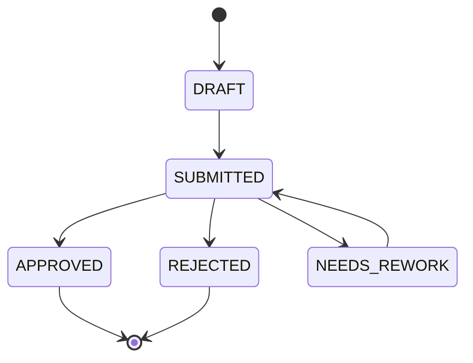

# Заявки продавцов · API-контракт

**OpenAPI 3.1 + AsyncAPI 2.6 + Kafka + ReDoc + Prism**

Часть проектной документации маркетплейса N, модуль заявок продавцов. Название компании, реквизиты и данные продавцов изменены.

Модуль допускает продавцов к продажам. Маркетплейс N продаёт ювелирные изделия малых брендов и частных мастеров. Продавец подаёт заявку с документами, юридический отдел проверяет её и принимает решение. Без одобренной заявки продавец не может выставлять товары.

Здесь лежит контракт модуля: REST API (OpenAPI 3.1) и событие о смене статуса в Kafka (AsyncAPI 2.6). Контракт описан до разработки (Contract-first): по нему backend и frontend могут работать параллельно, а QA — готовить тесты на mock-сервере.

## Что за API

```text
GET  /seller-applications                              Список заявок с фильтром и пагинацией (LEGAL_OFFICER — все, SELLER — свои)
POST /seller-applications                              Создать заявку (SELLER)
GET   /seller-applications/{applicationId}             Получить заявку (SELLER — свою, LEGAL_OFFICER — любую)
PATCH /seller-applications/{applicationId}             Изменить данные заявки (SELLER)
POST /seller-applications/{applicationId}/submit       Отправить на проверку (SELLER)
POST /seller-applications/{applicationId}/archive      Перенести в архив, мягкое удаление (SELLER)
POST /seller-applications/{applicationId}/restore      Восстановить из архива (SELLER)
POST /seller-applications/{applicationId}/decision     Принять решение (LEGAL_OFFICER)
```

Для каждой операции описаны входные и выходные данные, примеры, Bearer-аутентификация и ответы `400`, `401`, `403`, `404`, `409`.

### Статусы заявки



Переходы между статусами выполняют методы API:

- создание заявки, статус `DRAFT`: `POST /seller-applications`;
- отправка на проверку и повторная отправка, статус `SUBMITTED`: `POST /seller-applications/{applicationId}/submit`;
- решение юриста, статус `APPROVED`, `REJECTED` или `NEEDS_REWORK`: `POST /seller-applications/{applicationId}/decision`.

Правила, зашитые в контракт:

- у продавца может быть только одна незакрытая заявка, иначе `409 APPLICATION_ALREADY_EXISTS`;
- отправить можно только при наличии обязательных документов, иначе `409 REQUIRED_DOCUMENTS_MISSING`;
- операция в неподходящем статусе возвращает `409 INVALID_STATUS_TRANSITION`;
- решения `REJECTED` и `NEEDS_REWORK` требуют комментарий, иначе `400 COMMENT_REQUIRED`;
- изменить заявку можно только в `DRAFT` и `NEEDS_REWORK`, иначе `409 INVALID_STATUS_TRANSITION`;
- заявку в архиве нельзя изменить или отправить, иначе `409 APPLICATION_ARCHIVED`.

### Изменение заявки (PATCH)

Продавец передаёт только те поля, которые меняет. Формат тела — JSON Merge Patch (RFC 7396), `Content-Type: application/merge-patch+json`.

```http
PATCH /seller-applications/app-507
Authorization: Bearer <токен продавца>
Content-Type: application/merge-patch+json

{
  "legalForm": "LLC",
  "legalName": "ООО «Котова Ювелир»",
  "inn": "7723456789",
  "documents": [
    { "type": "REGISTRATION_RECORD", "fileId": "file-3210" }
  ]
}
```

| Поле | Можно менять | Правило |
|---|---|---|
| `contactEmail` | да | формат email |
| `legalName` | да | 3–255 символов |
| `legalForm` | только вместе с `inn` | у ИП ИНН из 12 цифр, у ООО из 10 |
| `inn` | только вместе с `legalForm` | ИНН определяет продавца, отдельно не меняется |
| `documents` | да | список передаётся целиком и заменяет прежний |
| `status`, `id`, `sellerId`, даты | нет | `400 INVALID_REQUEST` с названием поля |

Почему PATCH, а не PUT: PUT заменяет заявку целиком, и ради смены email клиенту пришлось бы присылать все поля и документы. Статус через PATCH не меняется: переходы между статусами идут только через `/submit` и `/decision`, где проверяются бизнес-правила.

### Архив вместо удаления

Метода `DELETE` нет. Заявку нельзя удалить физически: она нужна для истории проверок и споров с продавцом. Вместо этого продавец переносит её в архив.

| | Как работает |
|---|---|
| Что меняется | появляется поле `archivedAt` — когда заявку перенесли в архив, статус остаётся прежним |
| Что можно архивировать | `DRAFT`, `NEEDS_REWORK`, `REJECTED` |
| Что нельзя | `SUBMITTED` — заявка на проверке, `APPROVED` — продавец уже работает, его отключение — отдельный процесс |
| Список | по умолчанию архив скрыт, показать: `GET /seller-applications?archived=true` |
| Карточка | `GET /seller-applications/{id}` отдаёт заявку из архива, в ней видно `archivedAt` |
| Новая заявка | заявка в архиве не считается незакрытой и не мешает создать новую |
| Восстановление | `POST /{id}/restore` возвращает заявку в том же статусе. Черновик нельзя восстановить, если у продавца уже есть другая незакрытая заявка: `409 APPLICATION_ALREADY_EXISTS` |

Почему архив — поле, а не статус `ARCHIVED`: со статусом пропала бы история. Сейчас видно, что заявку сначала отклонили, а потом продавец убрал её в архив. И после восстановления понятно, в какой статус её вернуть.

Почему отдельные действия, а не `PATCH { "archived": true }`: архивация и восстановление проверяют свои правила (статус, наличие другой незакрытой заявки). Так же устроены `/submit` и `/decision`.

### Список заявок и пагинация

Юрист получает очередь на проверку: заявки в статусе `SUBMITTED`, сначала те, кто ждёт дольше всех.

В заявке две даты: `createdAt` — когда создана, `updatedAt` — когда менялась последний раз (правка, отправка, решение, архив). У заявки на проверке последнее изменение — это отправка, поэтому сортировка `updatedAt` по возрастанию и даёт очередь.

```http
GET /seller-applications?status=SUBMITTED&sort=updatedAt&page=1&size=3
Authorization: Bearer <токен юриста>
```

```json
{
  "items": [
    {
      "id": "app-498",
      "sellerId": "seller-019",
      "status": "SUBMITTED",
      "legalForm": "LLC",
      "legalName": "ООО «Серебряная нить»",
      "inn": "7701234567",
      "createdAt": "2026-10-21T15:40:00Z",
      "updatedAt": "2026-10-21T16:02:00Z"
    },
    {
      "id": "app-501",
      "sellerId": "seller-024",
      "status": "SUBMITTED",
      "legalForm": "IP",
      "legalName": "ИП Смирнова Анна Викторовна",
      "inn": "771234567890",
      "createdAt": "2026-10-22T09:10:00Z",
      "updatedAt": "2026-10-22T09:15:00Z"
    },
    {
      "id": "app-505",
      "sellerId": "seller-029",
      "status": "SUBMITTED",
      "legalForm": "IP",
      "legalName": "ИП Орлов Дмитрий Андреевич",
      "inn": "773456789012",
      "createdAt": "2026-10-22T11:00:00Z",
      "updatedAt": "2026-10-22T11:10:00Z"
    }
  ],
  "pagination": {
    "page": 1,
    "size": 3,
    "totalItems": 3,
    "totalPages": 1
  }
}
```

| Параметр | По умолчанию | Ограничения |
|---|---|---|
| `status` | все статусы | можно несколько: `status=SUBMITTED&status=NEEDS_REWORK` |
| `page` | 1 | от 1 |
| `size` | 20 | от 1 до 100, иначе `400 INVALID_PAGINATION` |
| `sort` | `-createdAt` (сначала новые) | `createdAt`, `-createdAt`, `updatedAt`, `-updatedAt` |

В списке приходит краткая карточка заявки, без документов и комментариев. Полную заявку отдаёт `GET /seller-applications/{applicationId}`.

## События в Kafka

Когда у заявки меняется статус, сервис заявок отправляет сообщение в Kafka. Сервис уведомлений получает его и пишет продавцу письмо, например что заявку одобрили или вернули на доработку.

Сервисы не зависят друг от друга: если сервис уведомлений временно недоступен, сообщения подождут его в Kafka и будут обработаны позже.

| | Значение |
|---|---|
| Брокер | Kafka, `localhost:9092` |
| Топик | `seller-application.status-changed.v1`, 3 партиции |
| Продюсер | Seller Verification Service, `clientId: seller-verification-service` |
| Подписчик | Notification Service, `groupId: notification-service` |
| Ключ сообщения | `applicationId` — события одной заявки идут в одну партицию и читаются по порядку |
| Заголовки | `content-type: application/json`, `event-type: SellerApplicationStatusChanged`, `correlation-id` |
| Значение | JSON в UTF-8 по схеме `schemas/asyncapi/application-status-changed-payload.yaml` |
| Гарантия доставки | at-least-once: продюсер ждёт `acks=all`, подписчик фиксирует offset после обработки |
| Повторы | подписчик не обрабатывает повторно уже известный `eventId` |
| Ошибки обработки | 3 повтора, затем сообщение уходит в `seller-application.status-changed.v1.dlt` |

### Сквозной пример: юрист вернул заявку на доработку

**1. HTTP: юрист принимает решение.**

```http
POST /seller-applications/app-501/decision
Authorization: Bearer <токен юриста>
Content-Type: application/json

{
  "decision": "NEEDS_REWORK",
  "comment": "Лист записи ЕГРИП старше 30 дней. Загрузите свежую выписку."
}
```

Ответ `200` с заявкой в статусе `NEEDS_REWORK`.

**2. Kafka: Seller Verification Service публикует сообщение.**

```text
topic:    seller-application.status-changed.v1
key:      app-501
headers:  content-type=application/json
          event-type=SellerApplicationStatusChanged
          correlation-id=trace-7f20b
```

```json
{
  "eventId": "evt-20031",
  "eventVersion": 1,
  "occurredAt": "2026-10-23T11:40:00Z",
  "correlationId": "trace-7f20b",
  "applicationId": "app-501",
  "sellerId": "seller-024",
  "actorId": "legal-007",
  "previousStatus": "SUBMITTED",
  "newStatus": "NEEDS_REWORK",
  "comment": "Лист записи ЕГРИП старше 30 дней. Загрузите свежую выписку."
}
```

**3. Kafka → Notification Service: подписчик читает сообщение** в группе `notification-service` и проверяет, что `evt-20031` ещё не обрабатывался.

**4. HTTP: Notification Service берёт email продавца.** Email не кладётся в событие, чтобы не копировать персональные данные по топикам.

```http
GET /seller-applications/app-501
Authorization: Bearer <сервисный токен Notification Service>
```

Из ответа берётся `contactEmail: anna.smirnova@example.com`.

**5. Notification Service отправляет письмо** с комментарием юриста и фиксирует offset в Kafka.

Ещё два примера сообщений, `submitted` и `approved`, лежат в `examples/asyncapi/` и показаны в документации AsyncAPI.

## Как устроен проект

```text
docs/         Схемы: исходники Mermaid (.mmd) и картинки (.png)
openapi/      OpenAPI-контракт
asyncapi/     AsyncAPI-контракт и сообщение
schemas/      Какие данные допустимы
examples/     Как выглядят конкретные данные
scripts/      Сборка документации AsyncAPI и запуск демо
```

Схемы и примеры разделены: операция отдельно ссылается на схему и на пример.

```yaml
schema:
  $ref: ../schemas/openapi/seller-application.yaml
examples:
  created:
    $ref: ../examples/openapi/application-created-response.yaml
```

## Как запустить

Нужны Git и Node.js 20.19–24 (рекомендуется 22 LTS).

```bash
git clone <адрес этого репозитория>
cd seller-verification
npm install
npm run demo
```

| Что | Адрес | Для чего |
|---|---|---|
| ReDoc | http://localhost:8080 | Документация OpenAPI |
| AsyncAPI | http://localhost:8080/asyncapi | Документация событий |
| Prism | http://localhost:4010 | Mock-сервер по контракту |

Страница AsyncAPI подгружает компонент документации из интернета (unpkg.com), поэтому для неё нужен доступ в сеть. Остановить демо: `Ctrl + C`.

Пример запроса к mock-серверу:

```bash
curl "http://localhost:4010/seller-applications?status=SUBMITTED&sort=updatedAt" \
  -H "Authorization: Bearer demo-token"
```

Prism проверяет, что токен передан, но не проверяет его подлинность и не хранит состояние: он возвращает ответы, описанные в контракте. Чтобы получить конкретный пример или ошибку, добавьте заголовок `Prefer`, например `Prefer: code=409, example=assayMissing` для `/submit`.

## Команды

```bash
npm run lint    # проверить OpenAPI-контракт
npm run build   # собрать документацию: dist/index.html и dist/asyncapi.html
npm run mock    # запустить только Prism
npm run demo    # собрать документацию и запустить ReDoc, AsyncAPI и Prism
```
